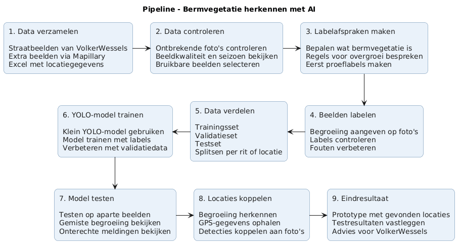

# Bermvegetatie- en Overgroeidetectie — VolkerWessels (`ai-s4_VW`)

Automatische herkenning en lokalisatie van bermvegetatie en mogelijke overgroei langs provinciale wegen op basis van straatbeelden met deep learning (YOLO).

---

## Inhoudsopgave
1. [Beschrijving en motivatie](#1-beschrijving-en-motivatie)
2. [Pipeline en werking](#2-pipeline-en-werking)
3. [Mappenstructuur](#3-mappenstructuur)
4. [Installatie](#4-installatie)
5. [Gebruik](#5-gebruik)
6. [Configuratie](#6-configuratie)
7. [Samenwerking en bijdragen (Contributing)](#7-samenwerking-en-bijdragen-contributing)
8. [Licentie](#8-licentie)
9. [Dankwoord en bronnen (Acknowledgements)](#9-dankwoord-en-bronnen-acknowledgements)
10. [Contact](#10-contact)

---

## 1. Beschrijving en motivatie

### Overzicht
Dit project ontwikkelt een werkend prototype voor het **Data Science & AI-team van VolkerWessels Infra Digital**. Het systeem gebruikt een deep-learningmodel (**YOLO**) om bermvegetatie op frontale straat- en dashcambeelden automatisch te herkennen en locaties met mogelijke overgroei als **XY-coördinaten** (gekoppeld aan het Nationaal Wegenbestand / GIS) terug te geven. Het project richt zich op provinciale wegen in Zuid-Holland.

### Motivatie
Bermen langs provinciale wegen moeten regelmatig gecontroleerd worden. Te hoge of te dicht bij de rijbaan groeiende vegetatie kan het zicht bij bochten en kruispunten blokkeren en verkeersborden afdekken. Momenteel gebeuren deze controles grotendeels handmatig door inspecteurs langs de weg. Dat kost veel tijd en geld, brengt veiligheidsrisico's met zich mee en kan leiden tot fouten bij het noteren van hectometerlocaties. Door straatbeelden automatisch te analyseren met AI kan VolkerWessels:
- grote weggebieden sneller en veiliger controleren zonder dat inspecteurs overal fysiek langs de weg hoeven te staan;
- onderhoud en controles gerichter inplannen op basis van gedetecteerde XY-coördinaten;
- bij de foutafweging sturen op een hoge **recall**, zodat gevaarlijke overgroei zo min mogelijk wordt gemist.

---

## 2. Pipeline en werking

Conform Hoofdstuk 10 van het Plan van Aanpak doorloopt onze oplossing negen stappen:



Het schema in `docs/pipeline.png` is het ontwerp uit het PvA; wijzigt de pipeline, dan passen we het schema in dezelfde Pull Request aan.

```text
1. Data verzamelen        -> Straatbeelden van VolkerWessels (5.910 JPG's), metadatabestand
                             (non_damage_images.xlsx, 5.911 rijen) en aanvullende Mapillary-beelden (N411, N210).
       |
       v
2. Data controleren       -> Opschonen metadata (ontbrekende foto image_id 1344834780613622 en lege
   & voorbereiden            kolommen creator/altitude verwijderen, compass_angle > 360 corrigeren,
                             seizoen toevoegen), onbruikbare beelden filteren (te donker, tegenlicht,
                             lucht, brug/rotonde), beelden naar gelijk formaat schalen en motorkap wegsnijden.
       |
       v
3. Labelafspraken maken   -> Criteria voor bermvegetatie en overgroei vastleggen met VolkerWessels,
                             eerst 50 beelden proeflabelen en 10% dubbel labelen op consistentie.
       |
       v
4. Beelden labelen        -> Begroeiing op de foto's met rechthoeken (bounding boxes) annoteren
                             en controleren op fouten.
       |
       v
5. Data verdelen          -> Verdelen in trainings-, validatie- en testset op basis van GPS-locatie
                             en rit (voorkomt dat beelden van hetzelfde wegvak in zowel train als test zitten).
       |
       v
6. YOLO-model trainen     -> Klein YOLO-model trainen op eigen hardware en verbeteren met validatiedata
                             (confidence-threshold afstemmen op hoge recall).
       |
       v
7. Model testen           -> Evalueren op aparte testset (gemiste begroeiing / false negatives en
                             onterechte meldingen / false positives, uitgesplitst naar seizoen).
       |
       v
8. Locaties koppelen      -> Gedetecteerde begroeiing koppelen aan GPS-coordinaten (XY) uit de metadata
                             en matchen met de echte weg via het Nationaal Wegenbestand (NWB / PDOK).
       |
       v
9. Eindresultaat          -> Prototype met gevonden locaties (XY-coordinaten / kaart), testresultaten
                             en advies voor VolkerWessels.
```

---

## 3. Mappenstructuur

De repository is ingericht volgens de richtlijn *GitHub Repository_Structure* van VolkerWessels Infra Digital en Hoofdstuk 12 van het Plan van Aanpak:

```text
ai-s4_VW/
├── README.md                  # Projectoverzicht, installatie- en gebruiksinstructies
├── LICENSE                    # Licentievoorwaarden
├── .gitignore                 # Bestanden en mappen die Git negeert (datasets, weights, caches)
├── environment.yml            # Conda-omgevingsconfiguratie (Python 3.11)
├── requirements.txt           # Python-packages voor pip
├── assets/                    # Statische afbeeldingen en diagrammen (bijv. pipeline-figuur)
├── config/                    # Configuratiebestanden (paden, crop-instellingen, thresholds)
│   └── config.yaml
├── data/                      # Datamap (volledige dataset staat niet in Git; alleen kleine voorbeeldset / .gitkeep)
│   ├── raw/                   # Lokale ruwe JPG-beelden en non_damage_images.xlsx
│   ├── processed/             # Opgeschoonde, bijgesneden en gesplitste train/val/test-data
│   └── sample/                # Kleine geanonimiseerde voorbeeldset voor tests en demonstratie
├── docs/                      # Aanvullende documentatie, pipeline-ontwerp en labelrichtlijn
├── examples/                  # Voorbeeldscripts en demo-runs
├── scripts/                   # Hulpscripts voor data-verkenning, Mapillary-download en NWB-koppeling
├── src/                       # Hoofdbroncode van de applicatie
│   ├── __init__.py
│   ├── main.py                # Startpunt (entry point) van het programma
│   ├── common/                # Algemene hulpfuncties die door het hele project gebruikt worden
│   │   ├── __init__.py
│   │   └── utils.py           # Data-validatie, config laden, bestands- en metadata-hulpfuncties
│   └── specific/              # Taakspecifieke functies voor dit project
│       ├── __init__.py
│       └── task_functions.py  # Preprocessing (crop/filter), YOLO-training/inferentie en GPS/NWB-koppeling
└── tests/                     # Unittests (pytest) voor kernfunctionaliteiten en edge cases
    └── test_utils.py          # Tests voor functies uit src/common/ en src/specific/
```

---

## 4. Installatie

### Vereisten (Prerequisites)
- **Python:** versie `3.11`
- **Conda** (Anaconda of Miniconda) of standaard Python `venv`
- **Git**
- Optioneel: NVIDIA GPU met CUDA voor het sneller trainen van YOLO

### Installatiestappen

1. **Clone de repository:**
```bash
git clone https://github.com/HU-AI-S4-2026AB/ai-s4_VW.git
cd ai-s4_VW
```

2. **Maak de omgeving aan en installeer de packages:**

**Optie A - met Conda (`environment.yml`, aanbevolen i.c.m. PyCharm):**
```bash
conda env create -f environment.yml
conda activate ai-s4-vw
```

**Optie B - met Python `venv` en `pip` (`requirements.txt`):**
```bash
python3.11 -m venv .venv
source .venv/bin/activate   # Op Windows: .venv\Scripts\activate
pip install --upgrade pip
pip install -r requirements.txt
```

3. **Data plaatsen:**
   - Plaats de door VolkerWessels aangeleverde JPG-foto's (`5.910` stuks) en het metadatabestand `non_damage_images.xlsx` lokaal in `data/raw/`.
   - Door `.gitignore` worden deze bestanden nooit naar GitHub gepusht.

---

## 5. Gebruik

> **Opmerking:** Onderstaande aanroepen vormen de CLI-template voor `src/main.py` en worden per sprint ingevuld naarmate de onderdelen uit de backlog worden opgeleverd.

### 1. Data controleren en voorbereiden (stap 2 & 5 uit de pipeline)
Verwijdert de ontbrekende foto (`image_id 1344834780613622`) en lege kolommen (`creator`, `altitude`), corrigeert `compass_angle > 360`, snijdt de motorkap weg, schaalt de beelden en splitst per rit/GPS-locatie:
```bash
python -m src.main --task preprocess --config config/config.yaml
```

### 2. YOLO-model trainen (stap 6 uit de pipeline)
Traint het YOLO-model op de trainingsset en valideert op de validatieset:
```bash
python -m src.main --task train --config config/config.yaml
```

### 3. Model testen en locaties koppelen (stap 7, 8 & 9 uit de pipeline)
Voert voorspellingen uit op straatbeelden, past de gekozen confidence-threshold toe en schrijft de gedetecteerde bermvegetatie met gekoppelde XY-coördinaten en NWB-wegnummers weg:
```bash
python -m src.main --task predict --input data/raw/ --output data/processed/predictions.csv
```

### 4. Unittests en codecontrole uitvoeren
Draai alle unittests (`pytest`) en de PEP 8-codecontrole (`ruff`) vanuit de hoofdmap:
```bash
pytest tests/
ruff check src/ tests/
```

---

## 6. Configuratie

Alle instellingen staan in `config/config.yaml`, zodat er geen vaste paden of drempelwaarden in de Python-code staan:
- `paths`: verwijzingen naar `data/raw/`, `non_damage_images.xlsx`, `data/processed/` en de map voor modelgewichten;
- `preprocessing`: doelresolutie, crop-fracties voor lucht en motorkap en een helderheidsfilter voor te donkere beelden;
- `split`: verdeling in train/validatie/test, gegroepeerd per rit of GPS-locatie, met vaste `random_seed`;
- `model`: gekozen YOLO-variant, `epochs` en `batch_size`;
- `evaluation`: `confidence_threshold` (uitkomst van deelvraag 4) en maximale afstand in meters naar het Nationaal Wegenbestand (NWB).

Waarden die nog op `null` staan zijn nog niet vastgesteld; het team vult ze in zodra ze onderbouwd zijn.

---

## 7. Samenwerking en bijdragen (Contributing)

### Branchstrategie
Wij werken volgens het branchmodel uit de richtlijn van VolkerWessels en Hoofdstuk 12 van ons Plan van Aanpak:
- `main`: bevat uitsluitend de stabiele, geteste versie (wordt aan het einde van elke sprint vanuit `develop` bijgewerkt).
- `develop`: de integratiebranch voor lopend ontwikkelwerk.
- `feature/<naam-van-taak>`: voor elke taak uit GitHub Projects maken we een aparte branch vanaf `develop` (bijv. `feature/data-cleaning`, `feature/nwb-gps-koppeling`, `feature/yolo-baseline`).

### Pull Requests en Definition of Done
- Code komt alleen in `develop` via een **Pull Request (PR)** die door minimaal één ander teamlid is gereviewd.
- Een taak is pas af (*Definition of Done*) als:
  1. de code voldoet aan **PEP 8** en voorzien is van **Type Hinting (PEP 484)** en **PEP 257 docstrings** (doel, parameters, returnwaarde);
  2. de bijbehorende unittests (inclusief edge cases) in `tests/` staan en slagen met `pytest`;
  3. de PR is goedgekeurd door een teamlid en de documentatie in `README.md` / `docs/` is bijgewerkt.

---

## 8. Licentie

Dit project wordt uitgevoerd binnen semester 4 van de opleiding HBO-ICT Artificial Intelligence (Hogeschool Utrecht) in opdracht van VolkerWessels Infra Digital.
- De repository is privé conform afspraak met VolkerWessels; de aangeleverde dataset van VolkerWessels mag niet openbaar worden verspreid.
- Openbare straatbeelden van Mapillary vallen onder de [CC BY-SA 4.0](https://www.mapillary.com/terms) licentie.
- Zie `LICENSE` voor de licentievoorwaarden van de broncode.

---

## 9. Dankwoord en bronnen (Acknowledgements)

- **VolkerWessels Infra Digital** — Anahita Khosravipour (Product Owner) en Tom (domein- en databegeleider) voor de dataset, de repository-richtlijn en de wekelijkse begeleiding.
- **PDOK / Nationaal Wegenbestand (NWB)** — voor de openbare wegvakgeometrie van provinciale wegen in Zuid-Holland.
- **Mapillary** — voor aanvullende straatbeelden van de N411 en N210.
- **Ultralytics YOLO** — voor het objectdetectie-framework.

---

## 10. Contact

Projectgroep VolkerWessels — Hogeschool Utrecht (HBO-ICT Artificial Intelligence, S4):
- **Miki Dağ**
- **Huub van Look**
- **Misha Leenders**

Bedrijfsbegeleider / Product Owner: **Anahita Khosravipour** (VolkerWessels Infra Digital).
